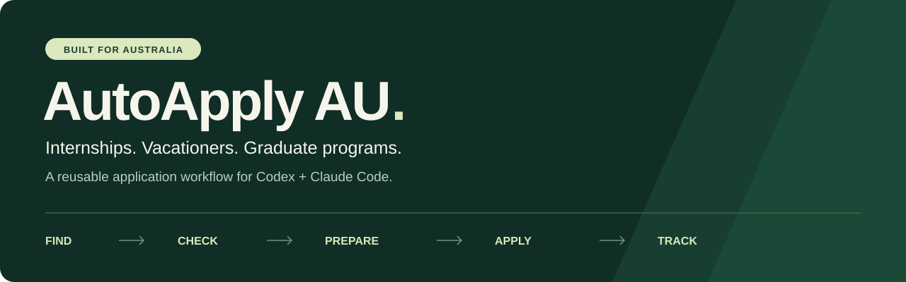

<p align="center">
  
</p>

<p align="center">
  <a href="https://github.com/Minhhh13/AutoApplyAU/actions/workflows/ci.yml"></a>
  <a href="https://www.python.org/downloads/"></a>
  <a href="LICENSE"></a>
  <a href="https://github.com/Minhhh13/AutoApplyAU/releases"></a>
</p>

<p align="center">
  <a href="#get-started">Get started</a> ·
  <a href="https://github.com/Minhhh13/AutoApplyAU/releases/latest/download/auto-au-applications.zip">Download the skill</a> ·
  <a href="docs/EXAMPLES.md">Example prompts</a> ·
  <a href="https://github.com/Minhhh13/AutoApplyAU/issues">Feedback</a>
</p>

# AutoApply AU

**An Australian internship and graduate application workflow for Codex and Claude Code.**

Give your agent a job link and say **“Apply to this role and track it.”** It checks your eligibility, tailors your documents, fills the employer's form and verifies the outcome. Link a Google Sheet once to see your applications and their latest status in one place.

Built for **internships, vacationer programs and graduate programs** across major Australian boards, specialist/startup platforms, university career portals, government job sites and employer careers pages. Each promising listing is checked against current employer requirements.

**Early release.** Testing covers a browser run on a fictional form, a Google Sheets update and 400 simulated application records. Live employer portals still need end-to-end testing. Search, document creation and form filling use the tools available in your Codex or Claude session. [What was tested](docs/VALIDATION.md)

## What it does

| Stage | What you get |
|---|---|
| Find | A source-backed shortlist with locations, intake dates, deadlines and links. |
| Check | Eligibility assessed against your degree, completion date, academic scale, work rights and availability. Unknowns stay visible. |
| Prepare | Tailored CV copies and application answers grounded in your confirmed experience. |
| Apply | “Apply to this link” authorises submission to that role. “Fill this form for my review” stops before submission. Both use your host's browser tools. |
| Track | One row per application in your linked Google Sheet. The local tracker keeps your full record and confirmation evidence. |
| Resume | Continue saved work and reconcile interrupted submissions before any retry. |

The workflow also supports original assessment practice and interview preparation. Live scored assessments are a separate stage and depend on their permitted-assistance rules.

## Where it searches

| Coverage | Discovery sources |
|---|---|
| General and early-career boards | Prosple, Indeed AU, GradConnection/SEEK, LinkedIn Jobs, Jora, Adzuna, Glassdoor and CareerOne. |
| Early careers and startups | Hatch and Wellfound, filtered for Australian internships and junior/graduate roles. |
| Specialist roles | EthicalJobs for social-impact work, eFinancialCareers for finance, and Engineers Australia for members' engineering opportunities. |
| Government | APS Jobs, I Work for NSW, Careers Victoria, Queensland Smart Jobs, WA Government Jobs, I WORK FOR SA, Tasmanian State Service, ACT Jobs and NT Government Jobs. |
| Universities | The applicant's own careers portal; examples include Sydney CareerHub, UNSW job opportunities and Monash's jobs board. |
| Employers | Current careers/program pages and the actual application destination. |

The agent chooses additional sources by discipline, location and existing university/member access. These are source-selection instructions used through your host's tools, not bundled connections to every platform. Login/access varies, and syndicated listings are deduplicated. [Source links and routing guidance →](auto-au-applications/references/australian-market.md)

## Get started

### 1. Get the project

```sh
git clone https://github.com/Minhhh13/AutoApplyAU.git
cd AutoApplyAU
```

You can also use **Code → Download ZIP** and extract it. For just the skill folder, use the [latest skill download](https://github.com/Minhhh13/AutoApplyAU/releases/latest/download/auto-au-applications.zip) and follow the [manual installation instructions](docs/GETTING_STARTED.md#manual-installation).

### 2. Install for your agent

You need **Python 3.10 or newer** for the installer and local helpers. No additional Python packages or API keys are required by these scripts. Access to a model and any browser/document tools comes from your chosen host.

**macOS / Linux**

```sh
python3 scripts/install.py --agent both
```

**Windows PowerShell**

```powershell
py -3 scripts/install.py --agent both
```

Use `--agent codex` or `--agent claude` to install for only one. The installer reports its destination and leaves an existing installation unchanged unless you request `--update`. See the [setup guide](docs/GETTING_STARTED.md) for project installs, custom directories and updates.

### 3. Open a new chat and set up your profile

In **Codex**:

```text
Use $auto-au-applications. Build my profile from the CV and transcript I provide.
Ask for any missing facts, then find Australian internships and graduate programs
matching my degree, qualification-completion date, work rights and preferred cities.
Shortlist 10 and show the employer sources. Use ./application-data for my files.
```

In **Claude Code**, invoke `/auto-au-applications` with the same request.

The agent saves a reusable profile and asks for missing facts. For a useful first search, provide your degree/major, qualification-completion month and year, preferred locations, availability and relevant work-rights details. You can supply application contact details later.

### 4. Apply from a link and track the result

```text
Create a Google Sheet for my applications and link it to this workspace.
Apply to this role using my saved profile and track the outcome: <job listing URL>
```

You can also give the agent an existing Google Sheet URL. Your host needs an authenticated Google Sheets integration with edit access. The agent updates the same row as the application progresses. If Sheets is offline, the local tracker keeps the change for the next sync. [Google Sheets setup and privacy](auto-au-applications/references/google-sheets.md)

## How it works

**Your profile → current listings → eligibility → tailored application → review/submission → tracker**

The skill supplies instructions and Australian market references. Your agent performs the research, reasoning and supported browser actions. Two local Python helpers maintain records and check answer structure, evidence references and word/character limits.

Files stay in the application directory you choose:

```text
application-data/
├── profile.json
├── applications.json
├── documents/
└── applications/
    └── app-…/
        ├── packet.json
        ├── tailored-cv.docx
        └── review.md
```

Choose the same data directory when switching between Codex and Claude. The packaged templates are blank. The actual document formats depend on the employer and the tools in your session.

## Choose how much to automate

| Ask | Behaviour |
|---|---|
| “Find 10 suitable programs” | Research and shortlist. |
| “Prepare these three applications” | Create tailored documents and answers. |
| “Apply to this link and track it” | Check, prepare, fill and submit that specific role when eligible and ready. Verify the result and update the tracker. |
| “Fill these three applications” | Fill supported forms and stop at final review. |
| “Submit these two reviewed applications” | Verify and send within that scope, then record actual confirmation. |
| “Resume my tracker” | Read saved progress and continue the requested stage. |

The agent asks when a required fact or material choice is missing. Login, MFA and CAPTCHA may need your input. If a portal or tool is unavailable, it preserves completed work and provides the remaining fields and files for you to finish.

## Australian details built in

- Qualification completion, graduation ceremonies and program intake are kept separate.
- WAM/GPA retains its original scale; conversions are not invented.
- Work rights, sponsorship and citizenship requirements are checked individually.
- Vacationer and graduate programs have their own eligibility windows.
- Deadline wording and stated timezone are preserved.
- Employer restrictions on streams, offices and repeat applications are checked before sending.
- Australian English is used, while CV length and format follow the actual employer's requirements.

Source access and job-board destinations can change. The agent rechecks them during each search and reports access gaps. [Australian market guidance →](auto-au-applications/references/australian-market.md)

## Current limits

The workflow runs inside a supported host session. Login, conditional questions, missing applicant facts and employer-specific declarations can require your input. Live employer submission throughput has not been benchmarked. An application counts as submitted only after the agent observes confirmation.

Local tracker/profile files are plaintext. The helper scripts make no network requests; the host's model, search and browser tools have their own data handling. Keep your real application files outside the repository and avoid including them in issue reports.

See [validation and known limits](docs/VALIDATION.md) for what has actually been tested.

## Contribute

Helpful contributions include Australian source updates, reproducible portal issues using fictional data, better eligibility examples and improvements to the portable helpers. See [CONTRIBUTING.md](CONTRIBUTING.md).

## Credits and licence

Inspired by [Thang Phung's AutoInternshipClaude](https://github.com/pqthangv/AutoInternshipClaude). This project adapts the workflow for the Australian market and supplies its own local helpers. The upstream extension and executables are not bundled. [Reference and attribution →](auto-au-applications/references/upstream-reference.md)

Released under the [MIT licence](LICENSE). Independent community project; not affiliated with OpenAI, Anthropic, the job boards or employers.
